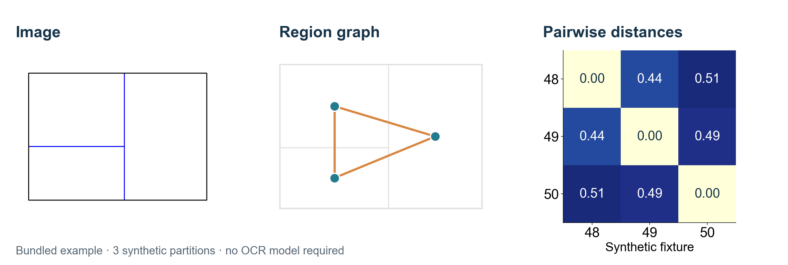

# PhaseGraph

**Turn phase diagrams into networks you can compare.**

[](https://github.com/KeyuanLai/PhaseGraph/actions/workflows/tests.yml)
[](https://www.python.org/)
[](LICENSE)

PhaseGraph extracts region adjacency graphs from phase-diagram images, compares their structure and finds similar diagrams. It provides a command-line interface and a Python API, without requiring matching phase names.



## Install

Python 3.10 or later is required.

```bash
python -m pip install "git+https://github.com/KeyuanLai/PhaseGraph.git@v0.1.1"
phasegraph doctor
```

You can also download a wheel from [Releases](https://github.com/KeyuanLai/PhaseGraph/releases) and install it with `python -m pip install <wheel-file>`.

## Quick start

Clone the repository to try the three bundled synthetic images:

```bash
git clone https://github.com/KeyuanLai/PhaseGraph.git
cd PhaseGraph
phasegraph extract --images examples/images --out output/graphs
phasegraph matrix --graphs output/graphs --out output/matrix
phasegraph fit --graphs output/graphs --out output/gallery
phasegraph query --model output/gallery/model.json --graph output/graphs/fixture_48/graph.json --top-k 3 --out output/query
phasegraph cluster --matrix output/matrix/distance_matrix.csv --groups 2 --out output/clusters
```

Extraction saves region nodes, contact edges, masks and a graph JSON. Comparison produces a labelled distance matrix; queries return ranked neighbours. Each run records its settings with its outputs.

For your own diagrams, replace `examples/images` with an image folder. The extractor supports thin blue or red boundaries on a light background. See the [usage guide](docs/usage.md) for repair options, input conventions and troubleshooting.

The source diagrams used in the study were obtained from [CompuTherm's phase-diagram collection](https://computherm.com/phase_diagrams). When preparing inputs from this collection, retain the original system identifiers and image resolution. The usage guide describes the supported image convention and the masks available for checking an extraction.

## Python API

```python
from phasegraph import DistanceModel, read_graph
from phasegraph.geometry import extract_image

graph, masks = extract_image("diagram.png")
reference = read_graph("reference.json")
model = DistanceModel(overflow="tail").fit([graph, reference])

distances = model.matrix()
neighbours = model.query(graph)
```

Graph JSON preserves isolated regions. A saved gallery keeps its calibration fixed when new diagrams are queried.

## Development

```bash
python -m pip install -e ".[dev]"
python -m unittest discover -s tests
python scripts/quickstart.py --out output/smoke
python -m build
```

Please include the command, package version and a small shareable example in bug reports. Contributions should describe the change and the relevant checks.

## License and citation

PhaseGraph is released under the [MIT license](LICENSE). Use [CITATION.cff](CITATION.cff) to cite the software.
