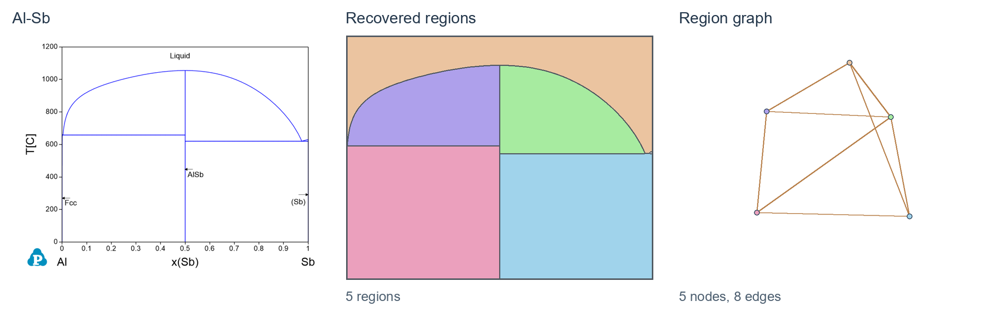
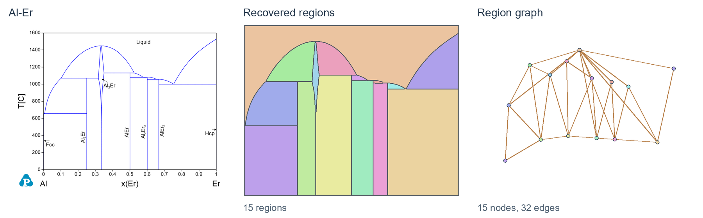
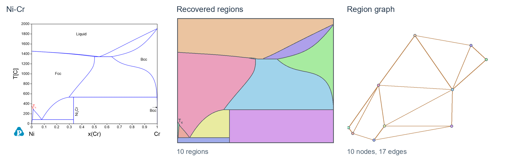
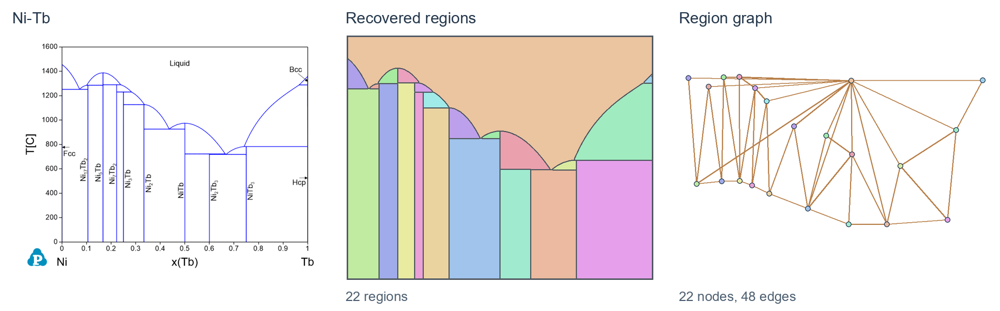

# Real phase-diagram examples

Four selected binary alloy diagrams illustrate extraction at different levels
of structural complexity. All use local repair and a processing width of
1024 pixels. They are worked examples rather than a benchmark dataset.

## Run

After installing PhaseGraph, run this command from the repository root:

```bash
python scripts/real_examples.py
```

The script saves extraction masks, graph files and the previews below in
`output/real_examples`. Choose another empty folder with `--out PATH`.

For extraction alone:

```bash
phasegraph extract --images examples/real/images --repair-strategy local --canonical-width 1024 --out output/real_graphs
```

The reference outputs in `graphs/` can also be loaded directly with
`phasegraph.read_graph`. Node positions use image coordinates, with the
vertical coordinate increasing downwards. Node colours link each recovered
region to its graph node; edges indicate detected contacts, not phase boundaries.

## Gallery

### Al-Sb

5 regions and 8 graph edges. [Source](https://computherm.com/al-sb)



### Al-Er

15 regions and 32 graph edges, including a narrow region beside the Al2Er label.
[Source](https://computherm.com/al-er)



### Ni-Cr

10 regions and 17 graph edges. [Source](https://computherm.com/Ni-Cr)



### Ni-Tb

22 regions and 48 graph edges, with multiple closely spaced phase boundaries.
[Source](https://computherm.com/Ni-Tb)



## Sources

The original diagrams were calculated with Pandat and published by
[CompuTherm](https://computherm.com/phase_diagrams). They retain their original
labels and marks. Their source pages and SHA-256 hashes are recorded in
`sources.csv`. Image rights remain with CompuTherm; the repository's MIT
license applies to the software, not to these third-party images.
